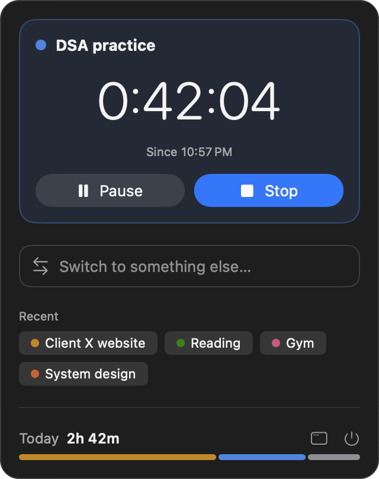
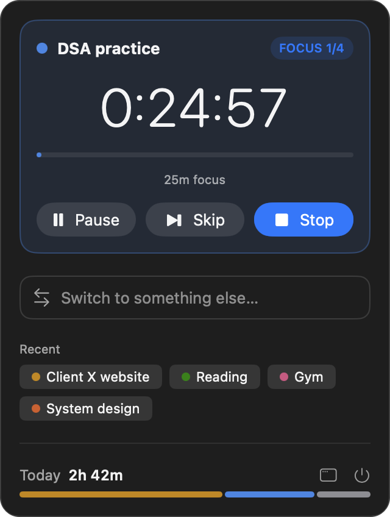
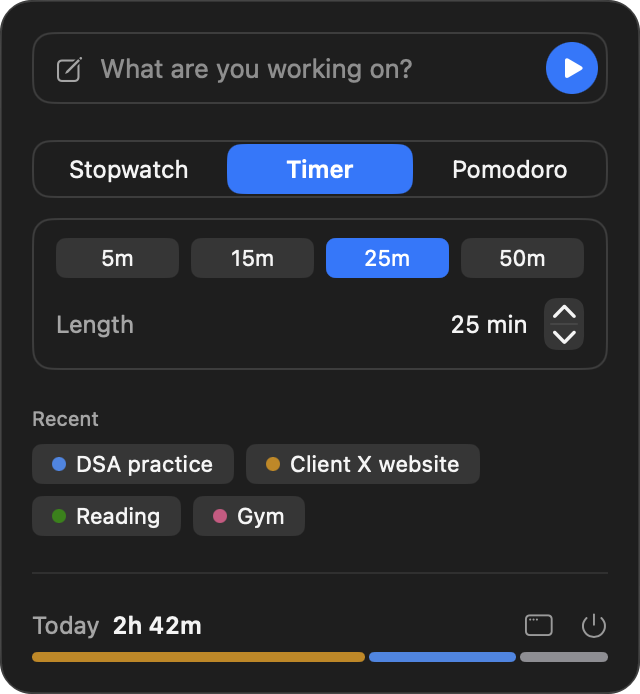
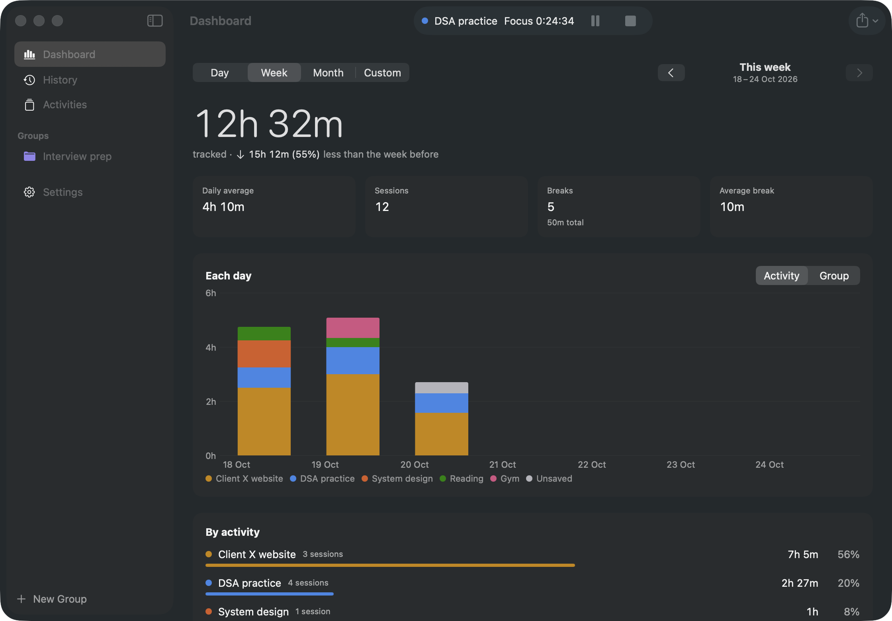
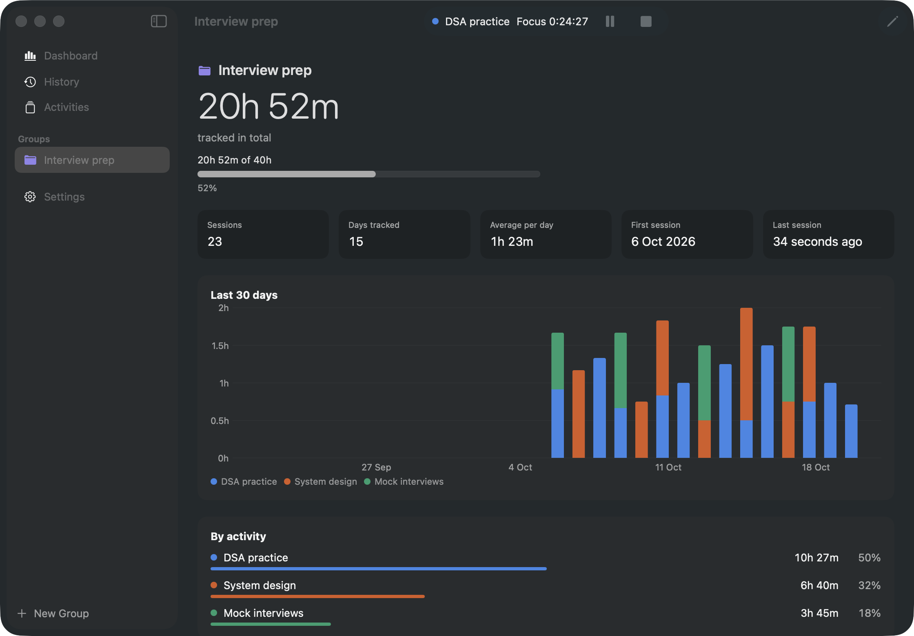
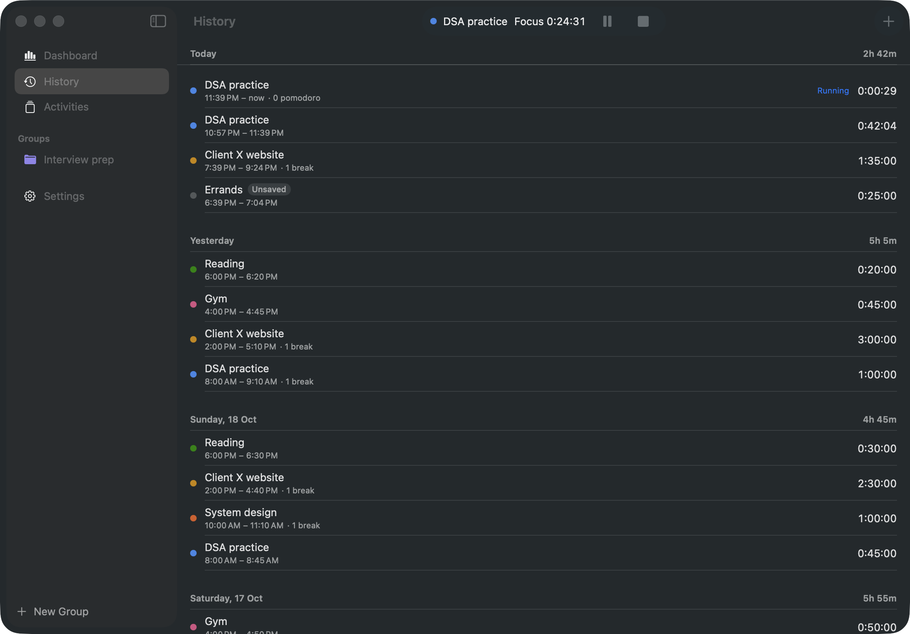

# Track Kar

*"Track kar" is Hindi for "track it".*

Track Kar is a minimal, native macOS menu bar app for personal time tracking. You start a timer with or without a name, pause it for breaks, and stop it when you're done. Your time adds up on saved activities across days, and a dashboard shows where it went. It also has a countdown timer and Pomodoro.

It's free, open source, and fully local: no account, no sync and no network access.

<p align="center">
  
  
  
</p>

<p align="center">
  
</p>

## Features

**In the menu bar**
- Start tracking in a keystroke: type what you're working on and press Return. Saved activities autocomplete.
- Stopwatch, countdown Timer (with presets) and Pomodoro (focus, short and long breaks).
- Pause for breaks. Breaks are counted but never added to your time.
- Switching tasks asks first: save and switch, move the time to the new task, or discard it.
- The menu bar item shows the live time, and you choose what it shows: icon, time, activity name, color dot, and time left for timers.
- A "Today" bar shows where the day went at a glance.

**In the main window**
- **Dashboard:** day, week, month or custom ranges; totals compared with the previous period; daily average; break stats; a stacked chart by activity or group; and a breakdown list.
- **History:** every session by day. Edit times and names, add time you forgot to track, or delete sessions.
- **Activities and Groups:** rename, recolor, archive and merge activities. Groups add up related activities (for example "Interview prep") and can have a target in hours.
- **Export:** CSV for spreadsheets, or JSON for a complete backup, for any range or everything.

**Thoughtful details**
- Crash-proof: time is stored as timestamps, so a running timer survives quitting, crashes and restarts.
- Time away: if your Mac sleeps or sits idle while a timer runs, Track Kar asks whether to keep that time.
- "Still tracking?" reminders after long stopwatch sessions.
- Global keyboard shortcuts.
- Light, Dark or System appearance, in **Liquid Glass** or an opaque **Solid** style, with your choice of accent color.

<p align="center">
  
  
</p>

## Install

### Download
1. Download the latest `Track-Kar-<version>.zip` from [Releases](https://github.com/PraveenKum11/track-kar/releases).
2. Unzip it and move **Track Kar.app** to your Applications folder.
3. Open it. Track Kar is free and isn't notarized by Apple, so macOS blocks it the first time:
   - Open **System Settings → Privacy & Security**, scroll down, and click **Open Anyway** next to the message about Track Kar. Then confirm.
   - Or run this once in Terminal:
     ```sh
     xattr -dr com.apple.quarantine "/Applications/Track Kar.app"
     ```

Track Kar appears in the menu bar (look for the timer icon), not in the Dock.

### Build from source
Requirements: macOS 26 Tahoe or later, and Xcode 26 or later.

```sh
git clone https://github.com/PraveenKum11/track-kar.git
cd track-kar
open TrackKar.xcodeproj
```

In Xcode, choose the **TrackKar** scheme and press **⌘R**. Xcode fetches the one dependency automatically.

## Keyboard shortcuts

| Shortcut | Action |
|---|---|
| ⌃⌥T (changeable) | Show or hide the menu bar popover, from any app |
| Return | Start the name you typed |
| Space | Pause or resume (while the name field isn't being typed in) |
| ⌘. | Stop |
| ⌘O | Open the main window |
| ⌘, | Settings |

Two more global shortcuts, **start/stop** and **pause/resume**, can be set in Settings → General.

## Privacy

Everything stays on your Mac, in the app's sandboxed container. Track Kar makes no network requests, has no analytics, and needs no account. Exports are written only where you choose in the save dialog.

## Development

```sh
xcodebuild -project TrackKar.xcodeproj -scheme TrackKar build
xcodebuild -project TrackKar.xcodeproj -scheme TrackKar test
```

**Debug launch arguments.** These only exist in Debug builds. Add them in Xcode under **Product → Scheme → Edit Scheme → Run → Arguments**:

| Argument | Effect |
|---|---|
| `-TrackKarSampleData YES` | Loads realistic sample data into an in-memory store; your real data is never touched |
| `-TrackKarSimulateAwayMinutes 25` | Shows the Welcome Back prompt as if you'd been away for 25 minutes |
| `-TrackKarStoreURL <path>` | Opens a specific store file, for example a copy for migration checks |

**App icon.** The icon is drawn in code. Edit `Scripts/make-app-icon.swift`, then run `swift Scripts/make-app-icon.swift` from the repository root.

**Dependencies.** The only third-party package is [KeyboardShortcuts](https://github.com/sindresorhus/KeyboardShortcuts) (MIT), for global shortcuts.

**Continuous integration.** GitHub Actions builds and tests every push and pull request.

**Releasing.**
1. Move the **Unreleased** notes in [CHANGELOG.md](CHANGELOG.md) into a new version section.
2. Commit, then push a tag like `v0.2.0`.
3. The Release workflow builds the app, attaches the zip, and uses that changelog section as the release notes.

### Project layout
```
TrackKar/
  App/          App entry, navigation, preferences, window activation
  Engine/       TimerEngine (the single source of truth), stats, ranges, away detection
  Models/       SwiftData models: activities, groups, entries, segments, breaks
  Features/     MenuBar, Dashboard, History, Activities, Settings, Welcome
  Services/     Notifications, global shortcuts, away monitor, export, launch at login
  Theme/        Glass and Solid styles, colors
  Shared/       Reusable views (charts, layouts) and sample data
TrackKarTests/  Unit tests (Swift Testing)
Scripts/        Tooling, such as the app icon generator
docs/           README screenshots
```

## License

Copyright © 2026 Praveen Kumar.

Track Kar is free software: you can redistribute it and/or modify it under the terms of the GNU General Public License as published by the Free Software Foundation, either version 3 of the License, or (at your option) any later version. See [LICENSE](LICENSE).
